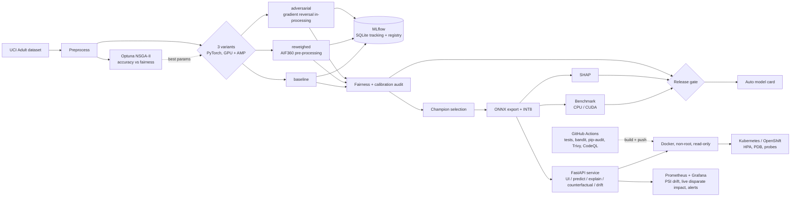

# Fair-MLOps: a Bias-Aware, GPU-Accelerated, Production-Style Deep-Learning Platform

Trains PyTorch models on the GPU, **audits and mitigates gender bias** (IBM **AIF360** reweighing *and* adversarial
debiasing), searches the **accuracy-vs-fairness Pareto front** with Optuna, tracks everything in **MLflow**, automatically
**selects a champion model** behind a **release quality gate**, exports to **ONNX (+INT8)**, serves it with a hardened
**FastAPI** service (web UI, explanations, counterfactual fairness checks, **drift + live-fairness monitoring**), and
deploys to **Docker / Kubernetes / OpenShift** with **Prometheus + Grafana** and a **security-scanned CI/CD** pipeline.

> New here? Read **[HOW_TO_RUN.md](HOW_TO_RUN.md)** - the complete step-by-step installation and execution guide.

## Architecture



## What makes it "advanced"

| Area | Feature |
|---|---|
| Deep learning / GPU | GPU-resident data + mixed precision (AMP), adversarial debiasing with a custom gradient-reversal autograd function, device auto-detection, `fairml.doctor` environment check |
| Responsible AI | Fairness metrics via AIF360 (NumPy fallback), 3 mitigation strategies compared, calibration (ECE) per group, SHAP, counterfactual fairness endpoint, auto-generated model card |
| Optimisation | Optuna multi-objective search -> Pareto front plot; ONNX Runtime + INT8; benchmark of PyTorch CPU / ONNX CPU / INT8 / PyTorch CUDA / ONNX CUDA |
| MLOps | MLflow 3 (SQLite) tracking + registry, data-driven **champion selection**, **release quality gate** (fails CI), exact environment capture + pip constraints |
| Monitoring | Prometheus metrics, PSI data-drift detection, **live disparate-impact gauge**, Grafana dashboard, alert rules |
| Serving | FastAPI, web demo UI, batch predict, per-request explanation, API key, rate limit, security headers, request IDs |
| Platform | Slim hardened Docker image, Kubernetes (HPA, PDB, probes, read-only FS, seccomp, optional NetworkPolicy), OpenShift Route |
| Security | latest dependency versions, Dependabot, pip-audit, bandit, CodeQL, Trivy, non-root container, CSP, see [SECURITY.md](SECURITY.md) |

## Quick start

```bash
python -m venv .venv && source .venv/bin/activate          # Windows: .venv\Scripts\Activate.ps1
pip install torch --index-url https://download.pytorch.org/whl/cu130   # GPU build (see HOW_TO_RUN.md Step 3)
pip install -r requirements.txt
python -m fairml.doctor                                    # is my GPU usable?
pytest -q
python -m fairml.pipeline --tune 20                        # tune + train + audit + export + benchmark + gate + model card
python -m uvicorn app.main:app --port 8000                 # UI http://localhost:8000
docker build -t fairml-api:latest . && docker compose up   # + Prometheus & Grafana
```

## Results  *(fill in with YOUR measured numbers from `artifacts/MODEL_CARD.md`)*

| Variant | Accuracy | ROC-AUC | Stat. parity diff (0 ideal) | Disparate impact (1 ideal) | Equal opp. diff (0 ideal) |
|---|---|---|---|---|---|
| baseline | _xx.x %_ | _0.xxx_ | _-0.xxx_ | _0.xxx_ | _-0.xxx_ |
| reweighed | _xx.x %_ | _0.xxx_ | _-0.xxx_ | _0.xxx_ | _-0.xxx_ |
| adversarial | _xx.x %_ | _0.xxx_ | _-0.xxx_ | _0.xxx_ | _-0.xxx_ |

| Engine (1 CPU thread / GTX 1650) | p50 latency, batch 1 | Throughput, batch 4096 |
|---|---|---|
| PyTorch CPU FP32 | _x.xxx ms_ | _xxxxx rows/s_ |
| ONNX Runtime CPU FP32 | _x.xxx ms_ | _xxxxx rows/s_ |
| ONNX Runtime CPU INT8 | _x.xxx ms_ | _xxxxx rows/s_ |
| PyTorch CUDA | _x.xxx ms_ | _xxxxx rows/s_ |

Charts to copy into `docs/images/`: `fairness_comparison.png`, `tuning/pareto_front.png`, `calibration.png`,
`benchmark.png`, `shap_importance.png`, a Grafana screenshot, and an MLflow compare-runs screenshot.

## Repository layout

```
fairml/    data, model, train, tune, fairness, calibration, drift, gate, export_onnx, benchmark, explain, model_card, pipeline, doctor
app/       FastAPI service: main, schemas, security, monitoring, static/ (demo UI)
tests/     pytest: data, fairness maths, drift, calibration/gate logic, training + adversary, MLflow, tuning, ONNX parity, every endpoint
monitoring/ Prometheus config, alert rules, Grafana provisioning + dashboard
k8s/       Namespace, ConfigMap, Deployment, Service, HPA, PDB, OpenShift Route, optional NetworkPolicy/Secret
.github/   CI/CD, CodeQL, Dependabot
scripts/   load_test.py, simulate_drift.py
```

## Key design decisions

- **Three mitigation strategies, compared honestly** (pre-processing, in-processing, none) and the winner is chosen by an
  auditable rule (`fairml/gate.py`), not by hand.
- **Fairness is a first-class release criterion**: the quality gate fails the build if disparate impact, equal-opportunity gap,
  calibration, ONNX parity or INT8 agreement are out of bounds.
- **PyTorch for training, ONNX Runtime for serving.** Slim image, no framework at runtime. The exporter tries the modern
  `torch.export` path first and falls back to the legacy one, validating every result against PyTorch.
- **Latest libraries, safely**: unpinned minimums for security patches; the serving image is *constrained* to the exact
  numpy/pandas/scikit-learn that pickled the preprocessor, and the API warns on mismatch.
- **Monitoring closes the loop**: the same fairness metric used at training time is computed live from production traffic.

## Limitations & ethical notes

- The Adult data is from 1994 and encodes historical bias; this is a demonstration, **not** a system for real decisions.
- `sex` is used as an input so mitigation effects are measurable; `/counterfactual` shows how much the model still depends on it.
  A real system must review whether using protected attributes is lawful and appropriate.
- Fairness is checked for one attribute; intersectional groups are not mitigated. Mitigation can cost accuracy.
- Fairness metrics are computed with AIF360 when it runs in your environment, otherwise with an equivalent NumPy implementation
  (the model card states which).

## Possible extensions

Kubeflow/Argo pipelines, distributed training (DDP), Evidently reports, model signing + SBOM, IBM Cloud Code Engine / watsonx.ai
deployment, equalized-odds post-processing, intersectional fairness audits.
